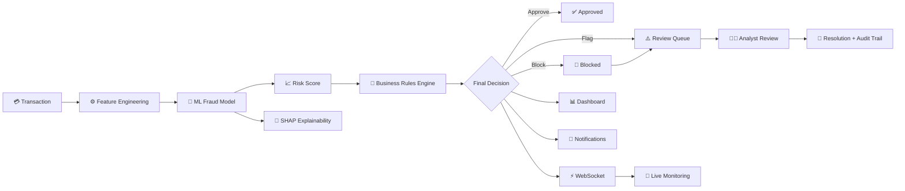

<div align="center">

# 🛡️ FraudGuard

### Stop fraud. Explain it. Prove it. Repeat.

**An AI fraud detection platform that doesn't just say "suspicious" — it shows its work.**

FraudGuard fuses **machine learning, SHAP explainability, a deterministic rules engine, real-time WebSocket monitoring, and a full analyst review workflow** into one dashboard built for how fraud teams actually operate.

<br/>

[](https://www.python.org/)
[](https://fastapi.tiangolo.com/)
[](https://react.dev/)
[](https://xgboost.readthedocs.io/)
[](https://www.postgresql.org/)
[](https://redis.io/)
[](https://developer.mozilla.org/en-US/docs/Web/API/WebSockets_API)
[](https://shap.readthedocs.io/)
[](LICENSE)

<br/>

**[⭐ Star this repo](https://github.com/RiyaJanday/Fraud-Guard)** · **[📖 Local setup](LOCAL_RUN.md)** · **[🚀 Deploy it](DEPLOYMENT.md)**

</div>

---

## 🚨 Every fraud model eventually gets asked "why?"

Most systems stop at:

> **"This transaction looks suspicious."**

That's not good enough for a real analyst, a real auditor, or a real customer dispute.

FraudGuard is built to answer the harder questions:

- **Why** did this transaction get flagged?
- **Which business rule** fired, and why?
- **What did the model actually predict** — and how confident was it?
- Should this be approved, flagged, or blocked — and **who decides**?
- **What happened after** the decision was made?

The result: an explainable, auditable, *operational* fraud pipeline — not a black box you have to trust blindly.

---

## ✨ What sets it apart

| Capability | FraudGuard |
|---|:---:|
| 🤖 ML-based fraud prediction | ✅ |
| 🧠 SHAP explanations per transaction | ✅ |
| 📏 Deterministic business-rule engine | ✅ |
| 🚫 Rules can override the model | ✅ |
| ⚡ Real-time WebSocket monitoring | ✅ |
| 🔎 Full transaction investigation | ✅ |
| 👩‍💻 Analyst review queue | ✅ |
| 🔐 JWT auth & role-based access | ✅ |
| 📊 Fraud analytics & live dashboards | ✅ |
| 📉 Data drift monitoring | ✅ |
| 📄 CSV / PDF reporting | ✅ |
| 🧾 Full audit trail | ✅ |
| 🧠 Model registry & version history | ✅ |

---

# 🏗️ How a Transaction Gets Judged



### The model doesn't get the final word

Here's what happens when a ₹75,000 transaction looks *statistically* fine but *policy-wise* isn't:

```text
Transaction Amount = ₹75,000

                 ML MODEL
                    ↓
           Fraud Probability
              0.0525%
                    ↓
              Risk Score 0.05
                    ↓
                APPROVE
                    │
                    ▼
          BUSINESS RULE ENGINE
                    │
        ┌───────────┴───────────┐
        ↓                       ↓
 Amount > ₹50,000          Amount > ₹20,000
        ↓                       ↓
      BLOCK                    FLAG
        └───────────┬───────────┘
                    ↓
              🚫 BLOCKED
                    ↓
             REVIEW QUEUE
```

Machine learning gives you intelligence. Business rules give you control. FraudGuard never lets the model overrule policy.

---

# 🚀 Core Features

## 🤖 1. AI Fraud Detection

Every transaction runs through an ML inference pipeline that returns:

- Fraud probability
- Risk score
- Confidence
- Final decision
- Model version
- Inference latency

Powered by an XGBoost fraud classifier, with every version tracked in the Model Registry.

---

## 🔬 2. Explainable AI — No Black Boxes

Fraud detection shouldn't require blind trust.

FraudGuard generates a **SHAP explanation for every transaction**, ranking the features that actually drove the decision:

```text
Top contributing signals

1. Hour
2. Amount_log
3. Amount
4. V1
5. V18
```

Each signal comes with:

- Feature name & human-readable label
- Feature value
- SHAP impact
- A plain-language explanation

So analysts investigate *reasons*, not just scores.

---

## 📏 3. Business Rules Engine

ML is one signal — not the whole decision.

FraudGuard layers deterministic rules on top, like:

```text
IF amount > 50000
THEN BLOCK
```

```text
IF amount > 20000
THEN FLAG
```

Multiple rules can fire on a single transaction, and the final call blends the model's read with active policy — every time.

---

## ⚡ 4. Real-Time Live Monitoring

Transactions stream straight to the dashboard over **WebSockets** — no refresh, no polling, no lag.

Live Monitoring gives you:

- Real-time transaction feed
- Merchant & amount
- Risk indicator
- Approved / blocked status
- One-click stream controls

If it's happening, you're seeing it.

---

## 🕵️ 5. Analyst Review Queue

Blocked and high-risk transactions don't just vanish — they enter a human-in-the-loop workflow:

```text
BLOCKED TRANSACTION
        ↓
PENDING REVIEW
        ↓
CLAIM CASE
        ↓
INVESTIGATE
        ↓
SHAP + BUSINESS RULES
        ↓
┌───────────────┐
│ LEGITIMATE    │
│      OR       │
│ CONFIRM FRAUD │
└───────────────┘
        ↓
AUDIT TRAIL
```

Analysts get the full picture before making the final call.

---

## 📊 6. Fraud Detection Dashboard

Your fraud pipeline's mission control:

- Total transactions
- Fraud detected & blocked
- Detection accuracy
- Average risk score
- Transaction volume over time
- Fraud distribution breakdown
- Risk trend
- Model performance snapshot
- Live risk gauge
- Fraud heatmap by day & hour
- Recent alerts
- Notifications

---

## 📉 7. Drift Monitoring

Fraud doesn't hold still — and neither should your model's confidence in itself.

FraudGuard continuously compares live transaction behavior against the reference distribution the model was trained on, answering:

> "Is the traffic coming in today still what the model thinks it's looking at?"

---

## 🧠 8. Model Registry

Full visibility into what's actually running in production:

- Active model & algorithm
- Accuracy, precision, recall
- F1, ROC-AUC, PR-AUC
- Training timestamp
- Complete version history

The foundation for reproducible MLOps and painless retraining later.

---

## 🔐 9. Authentication & Role-Based Access

- JWT authentication
- Admin & Analyst roles
- Protected routes
- Password reset flow
- Role-based access control

---

## 🧾 10. Audit Trail

Every review action and case resolution is logged — because fraud decisions need a paper trail, not just a verdict.

---

## 📄 11. Reports

Export to **CSV** or **PDF** for analysis, compliance, or that stakeholder demo you didn't have time to prep for.

---

# 🖥️ Dashboard Preview

> Add your screenshots to a `docs/screenshots/` folder and uncomment the images below.

```text
docs/
└── screenshots/
    ├── dashboard.png
    ├── transactions.png
    ├── live-monitoring.png
    ├── review-queue.png
    ├── model-registry.png
    └── business-rules.png
```

### Overview

<!--  -->

### Live Monitoring

<!--  -->

### Transactions

<!--  -->

### Review Queue

<!--  -->

### Model Registry

<!--  -->

---

# 🧰 Tech Stack

## Backend

| Technology | Purpose |
|---|---|
| **Python** | Core backend & ML ecosystem |
| **FastAPI** | REST API |
| **SQLAlchemy** | ORM / database access |
| **Alembic** | Database migrations |
| **PostgreSQL** | Persistent database |
| **Redis** | Caching / supporting infrastructure |
| **XGBoost** | Fraud classification |
| **scikit-learn** | ML preprocessing & evaluation |
| **SHAP** | Model explainability |
| **WebSockets** | Real-time updates |
| **JWT** | Authentication |

## Frontend

| Technology | Purpose |
|---|---|
| **React 19** | UI |
| **Vite** | Development/build tooling |
| **Tailwind CSS** | Styling |
| **Chart.js** | Analytics visualizations |
| **React Hook Form** | Form management |
| **Zod** | Validation |
| **Axios** | API communication |

## Infrastructure

```text
Docker
├── PostgreSQL
├── Redis
└── FastAPI backend

React/Vite frontend
        ↓
     REST API
        +
   WebSockets
```

---

# 📁 Project Structure

```text
Fraud-Guard/
│
├── fraudguard-backend/
│   └── app/
│       ├── api/
│       │   └── v1/
│       │       ├── auth/
│       │       ├── transactions/
│       │       ├── analytics/
│       │       ├── drift/
│       │       └── ...
│       │
│       ├── core/
│       │   ├── config/
│       │   ├── security/
│       │   └── logging/
│       │
│       ├── ml_engine/
│       │   ├── model training
│       │   ├── inference
│       │   ├── SHAP explainer
│       │   └── drift detection
│       │
│       ├── models/
│       ├── repositories/
│       ├── schemas/
│       └── services/
│
├── fraudguard-frontend/
│   └── src/
│       ├── components/
│       ├── context/
│       ├── lib/
│       └── pages/
│
├── docker-compose.yml
├── seed_transactions.py
├── creditcard.csv
├── LOCAL_RUN.md
├── DEPLOYMENT.md
├── LICENSE
└── README.md
```

---

# ⚡ Quick Start

## Prerequisites

Install:

- Git
- Docker Desktop
- Node.js
- Python 3.11

### 1️⃣ Clone

```bash
git clone https://github.com/RiyaJanday/Fraud-Guard.git
cd Fraud-Guard
```

### 2️⃣ Start backend infrastructure

```bash
docker compose up --build
```

Wait until the backend reports:

```text
Application startup complete
```

Then open:

**http://127.0.0.1:8000/docs**

### 3️⃣ Start frontend

Open another terminal:

```bash
cd fraudguard-frontend
npm install
npm run dev
```

Open the Vite URL shown in the terminal, usually:

```text
http://localhost:5173
```

### 4️⃣ Create an account

Register through the authentication flow. The first account registered becomes the administrator account.

---

# 🧪 Take It For a Spin

FraudGuard can be tested directly from Swagger.

Open:

```text
http://127.0.0.1:8000/docs
```

Find:

```text
POST /api/v1/predict
```

Try a high-value transaction and watch the pipeline make its call:

```json
{
  "time_feature": 0,
  "amount": 75000,
  "currency": "INR",
  "merchant": "Test Merchant",
  "customer_reference": "TEST-CUSTOMER-001",
  "card_last4": "4242",
  "device_info": "Test Device",
  "ip_address": "127.0.0.1",
  "location": "Ahmedabad",
  "v_features": {
    "V1": 0.12,
    "V2": -0.31,
    "V3": 0.08,
    "V4": 0.22,
    "V5": -0.15,
    "V6": 0.41,
    "V7": -0.27,
    "V8": 0.13,
    "V9": -0.09,
    "V10": 0.35,
    "V11": -0.18,
    "V12": 0.06,
    "V13": 0.24,
    "V14": -0.12,
    "V15": 0.17,
    "V16": -0.21,
    "V17": 0.09,
    "V18": 0.14,
    "V19": -0.33,
    "V20": 0.19,
    "V21": -0.07,
    "V22": 0.28,
    "V23": -0.16,
    "V24": 0.11,
    "V25": 0.05,
    "V26": -0.23,
    "V27": 0.18,
    "V28": -0.04
  }
}
```

### The decision flow you should see

```text
₹75,000
   ↓
ML model
   ↓
Low ML risk
   ↓
Business rules
   ↓
amount > 50,000
   ↓
🚫 BLOCKED
   ↓
Review Queue
```

That's the whole point:

> **The model provides intelligence. The rules provide control. Together, they decide.**

---

# 🔄 End-to-End Workflow

```text
                  ┌───────────────┐
                  │   Transaction │
                  └───────┬───────┘
                          ↓
                  ┌───────────────┐
                  │ Validation    │
                  └───────┬───────┘
                          ↓
                  ┌───────────────┐
                  │ Preprocessing │
                  └───────┬───────┘
                          ↓
              ┌───────────────────────┐
              │     ML Prediction     │
              └───────────┬───────────┘
                          ↓
                Probability + Risk
                          ↓
              ┌───────────────────────┐
              │   Business Rules      │
              └───────────┬───────────┘
                          ↓
                  Final Decision
                          ↓
        ┌─────────────────┼─────────────────┐
        ↓                 ↓                 ↓
     APPROVE            FLAG              BLOCK
        │                 │                 │
        │                 └──────┬──────────┘
        │                        ↓
        │                 Review Queue
        │                        ↓
        │                 Analyst Review
        │                        ↓
        │                 Human Decision
        │                        ↓
        └───────────────→ Audit Trail

              ↘ WebSocket → Live Monitoring
              ↘ Analytics → Dashboard
              ↘ SHAP → Explainability
              ↘ Events → Notifications
```

---

# 📈 Model Evaluation

The Model Registry tracks the metrics that actually matter for fraud:

```text
Accuracy
Precision
Recall
F1 Score
ROC-AUC
PR-AUC
```

> **Heads up:** accuracy alone is meaningless here — fraud datasets are wildly imbalanced. That's why precision, recall, F1, ROC-AUC, and PR-AUC are tracked side by side, not in isolation.

---

# 🔐 Security

FraudGuard ships with application-level security baked in:

- JWT-based authentication
- Role-based authorization
- Protected API routes
- Password reset flow
- Audit logging
- Input validation
- Rate limiting
- Environment-based configuration

### ⚠️ Before you deploy

Never commit:

```text
.env
database passwords
JWT secrets
API keys
private credentials
```

Use environment variables or a secret manager in production. Always.

---

# ☁️ Deployment

Built to deploy cleanly across:

```text
Frontend  → Vercel
Backend   → Render
Database  → PostgreSQL
Cache     → Redis
```

Full walkthrough in [`DEPLOYMENT.md`](DEPLOYMENT.md).

---

# 🗺️ Roadmap

- [x] ML fraud prediction
- [x] SHAP explainability
- [x] Business rules
- [x] Transaction monitoring
- [x] Real-time WebSocket feed
- [x] Analyst review queue
- [x] Dashboard analytics
- [x] Model registry
- [x] Drift monitoring
- [x] Audit trail
- [x] CSV/PDF reports
- [ ] Automated model retraining pipeline
- [ ] Advanced rule simulation
- [ ] Champion/challenger model evaluation
- [ ] Expanded production observability
- [ ] Cloud deployment hardening

---

# 🎯 Built on Four Principles

### 1. **Accuracy**
Use machine learning to catch patterns humans would miss.

### 2. **Explainability**
Show analysts exactly *why* a transaction got its risk score.

### 3. **Control**
Let deterministic policy override the model when it has to.

### 4. **Operations**
Turn a prediction into a complete monitoring and review workflow — not just an API response.

---

# 💡 Picture This

A customer makes a first-time ₹75,000 transaction.

The model says: **low risk.**

But your policy says:

> First-time customers spending above ₹50,000 get blocked for review. No exceptions.

FraudGuard doesn't pick a side — it enforces both:

```text
ML says:
"Low risk"

Business Rules say:
"Policy violation"

FraudGuard says:
"BLOCK"
```

The analyst picks it up with everything they need already laid out — transaction details, risk score, SHAP explanation, triggered rules, and decision history — and makes the final human call.

---

# 🏆 More Than a Model — A Full ML Lifecycle

```text
                DATA
                 ↓
           PREPROCESSING
                 ↓
          MODEL TRAINING
                 ↓
             INFERENCE
                 ↓
          EXPLAINABILITY
                 ↓
        BUSINESS DECISIONS
                 ↓
          HUMAN REVIEW
                 ↓
          AUDIT + REPORTING
                 ↓
        MONITORING + DRIFT
                 ↓
          FUTURE RETRAINING
```

Machine Learning + Backend Engineering + Frontend Engineering + Real-Time Systems + Explainable AI + MLOps — in one repo.

---

# 👩‍💻 Author

### Raghvendra Rai

B.Tech Computer Science Engineering — AI

Building at the intersection of:

- 🤖 Artificial Intelligence
- 🧠 Machine Learning
- 💻 Software Engineering
- 📊 Data & Analytics
- 🚀 Production-grade AI systems

---

<div align="center">

### 🛡️ FraudGuard

**Don't just detect fraud. Understand it. Act on it. Learn from it.**

<br/>

⭐ **If this project's your kind of build, star the repo — it helps more than you'd think.**

**[GitHub Repository](https://github.com/RiyaJanday/Fraud-Guard)**

</div>
